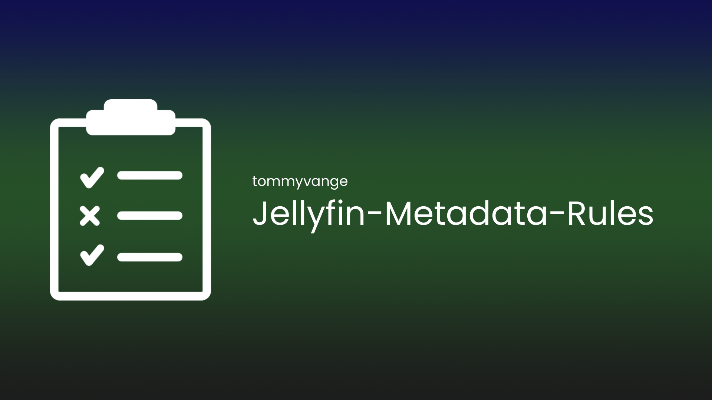

# Metadata Rules for Jellyfin



Set metadata language and country for movies and series using explainable rules. Build nested conditions visually, preview the result, then apply preferences alone or request metadata replacement. Seasons and episodes are available as explicit rule targets and descendant scopes.

The plugin targets **Jellyfin 12.4.0 (v12.4), using .NET 10**. CI also compiles against the latest stable Jellyfin API when it differs from that baseline. Automated checks use synthetic facts and mocked server services; acceptance testing on a running Jellyfin server has not yet been completed.

## Install

Download the plugin ZIP from a published GitHub release, or build the local package below. For a manual installation:

1. Stop Jellyfin.
2. Create a dedicated directory such as `Metadata Rules_1.0.2.0` inside Jellyfin's configured `plugins` directory.
3. Extract **all three files** directly into that directory:

   ```text
   Jellyfin.Plugin.MetadataRules.dll
   meta.json
   Jellyfin-Metadata-Rules.png
   ```

4. Start Jellyfin and open **Dashboard → Plugins → Metadata Rules** as an administrator.

Preserve the separate plugin configuration and data when upgrading. Jellyfin supplies the runtime and server assemblies; Node.js is needed only for development and packaging.

After the first successful release, add this repository under **Dashboard → Plugins → Repositories** to install and update through Jellyfin:

```text
https://raw.githubusercontent.com/tommyvange/Jellyfin-Metadata-Rules/manifest/manifest.json
```

That catalog URL is created by the release workflow and is unavailable until a release has been published. Deployment uses GitHub Releases, a dedicated `manifest` branch, and GitHub Actions' built-in token, matching Jellyfin Infinite Scroll. See [publishing instructions](docs/releasing.md).

## First run

1. In **General**, select the libraries to process and save. **No selected libraries means no library-wide candidates.** The initial rule list is empty, so installation alone changes no media.
2. In **Rules**, add a template or create a ruleset. Select its item kinds, build its conditions, and choose language, country, and optional refresh actions. Rules use library IDs; library names are display labels.
3. In **Preview**, validate the draft and run a dry-run for selected libraries or specific item IDs. Inspect condition evidence, explicit before/after values, inherited effects, refresh targets, and skipped/deferred reasons.
4. Apply the completed preview after reviewing its results. Execution re-reads the same candidate IDs and reports changed plans instead of applying stale proposals. A truncated preview cannot be applied; narrow its scope or increase the report limit and preview again.
5. Use **History** for searchable results, item traces, report export, cancellation, and persistence/refresh outcomes. Draft rules can also be imported and exported as versioned JSON.

The global enable switch controls execution; preview remains available while disabled. Automatic triggers have separate switches:

| Trigger | Default | Behavior |
| --- | --- | --- |
| Nightly | Enabled | Daily at 03:00 in the Jellyfin server's local timezone. Change the schedule in **Dashboard → Scheduled Tasks → Apply Metadata Rules**. Saving plugin settings preserves that schedule. |
| Run after full library scan | Off | Queues reconciliation after a full scan. Targeted folder refreshes do not all use this hook. |
| Instant processing | Off | Debounces new items, waits for required stored facts, and retries unavailable facts within a bounded window. Later updates wake pending items; episode/version changes reconcile their owning aggregates. |

Still-deferred items remain visible for a later manual or nightly reconciliation. Concurrent triggers share one worker, with one active metadata refresh.

## How rules decide

Rulesets run in displayed order. Each contains IF, ELSE IF, and optional terminal ELSE branches. The **first matching branch wins**, and its action list is the only one applied in that evaluation. A branch with unknown required facts defers the decision and blocks lower-priority branches and rulesets. ELSE runs only after earlier branches are definitively false. A branch with no actions can deliberately stop further rules.

Conditions support nested AND, OR, NOT, scalar/set comparisons, and correlated any/all/none/count tests over versions, streams, and episodes. A single audio track must satisfy every condition inside its track group. Known empty collections differ from unavailable collections: ANY is false, NONE is true, and ALL requires at least one element. “Is missing” can match confirmed absence; unfinished facts remain unknown.

**Original language (metadata)** is the provider's stored original-language value. It is separate from actual audio tracks and is never inferred from titles, countries, or the default audio track.

When an item's original language, or its inherited series original language, is **confirmed absent**, Equals, Does not equal, Is one of, and Is none of return a nonmatch. Evaluation can continue to a later branch, such as a Norwegian-audio rule. Absence does not identify the work's actual original language. Unfinished metadata, read errors, and unsupported original-language facts remain Unknown and defer lower-priority branches. Use **Is missing** when a rule should explicitly match confirmed absence. This original-language behavior does not change missing comparisons for other fields.

The Norwegian templates distinguish:

- **Norwegian, any variant:** accepts `no`/`nor`, `nb`/`nob`, and `nn`/`nno`.
- **Exact Norwegian, Bokmål, or Nynorsk:** preserves those separate language choices.
- **Norwegian audio:** can inspect any local playable movie version, or available episodes and their versions for a series. Evidence identifies the supporting version and stream.

Choose the output language explicitly, such as generic Norwegian `no` or Bokmål `nb`, and metadata country **Norway / NO**. Language and country choices come from Jellyfin's localization catalog.

The field registry includes identity/library scope, metadata preferences, original language, genres/tags/studios/production locations, dates and ratings, provider IDs, people, file properties, audio/subtitle/video streams, series, episode, and lock/location state. Each field declares its type, operators, applicability, and availability. Production locations remain provider strings rather than ISO country codes. Text comparison uses ordinal case-insensitive matching. Configure **Path case sensitivity** in General for the filesystem that stores your media; its initial default is insensitive on Windows/macOS and sensitive elsewhere.

**Age rating** compares Jellyfin's stored official rating; **Custom age rating** compares its separate custom rating. The visual builder offers suggestions from values already used in stored library metadata, separately for each field, while retaining text entry. Existing rules keep the stable field IDs `rating.official` and `rating.custom`. Both use text operators, so regional labels such as `TV-14`, `PG-13`, or custom values retain their meaning without assuming a universal numerical age scale.

## Actions and repeat behavior

Language and country independently support **Leave unchanged**, **Set catalog value**, and **Clear override → inherit**. Preference-write scope and refresh scope are separate. Descendant overrides are preserved unless explicit descendant writes enable overwrite; preview reports inherited effects separately. Locked items are skipped before writes or refreshes.

Refresh defaults to none. **Replace all metadata** uses Jellyfin's full metadata replacement flags; **Replace all metadata & images** also enables full image replacement. Replacement can remove previous fields that providers do not return. Metadata-only mode avoids remote image replacement, although Jellyfin may still register local artwork. Preferences are persisted before an awaited, single-item refresh attempt.

Normal preference persistence can invoke Jellyfin's metadata savers, including NFO savers. Local metadata and provider settings can affect the final locale or content. A conflicting stored locale or a repeating locale/winning-branch cycle pauses further automatic changes for that item and records the reason. “Refresh attempt completed” means Jellyfin's awaited call returned; it does not guarantee provider success or localized content.

A durable per-item journal suppresses repeated replacement for an unchanged decision. Rules can instead require a preference change or allow repeated runs subject to a minimum interval. Failed refresh stages remain retryable. **Force this reviewed run** bypasses repeat suppression for one specific completed preview. Restart recovery records interrupted/uncertain actions and bounds automatic retries; external provider effects are not guaranteed exactly once.

## Data and limits

Settings use Jellyfin's normal plugin configuration file. Nested rules are stored as a versioned `RulesJson` string so they round-trip through Jellyfin's XML configuration storage.

Reports and decision journals live under `<Jellyfin data directory>/metadata-rules/`, separately from Jellyfin's database:

- `jobs/`: recent run summaries and item-result JSONL files. Defaults retain 50 completed runs and up to 10,000 result rows per run; both are configurable.
- `journal/`: per-item decisions and action stages. These survive report expiry so an unchanged rule does not repeatedly replace metadata. Removing these files resets that suppression.

Rules are limited to 256 KiB, 128 rulesets, 2,048 condition nodes, and depth 24. A job supports up to 100,000 candidate IDs; the worker queue and instant-item queues are bounded. All custom endpoints require Jellyfin administrator elevation. The rules engine evaluates typed data and never executes user-authored scripts.

## Build and verify

Use .NET SDK 10, Node.js 20 or newer, and `zip`/`unzip`. There are no npm dependencies to install.

```sh
npm test
npm run build
npm run package
node scripts/validate-package.mjs
```

The current package is `artifacts/Jellyfin.Plugin.MetadataRules_1.0.2.0_jellyfin-12.4.0.zip`, with a SHA-256 sidecar. `npm test` covers the pure rule engine, coordinator behavior, Jellyfin 12.4 adapter contracts, event snapshots, native XML configuration persistence, and release tooling. See [architecture and verification boundaries](docs/architecture.md) for what these checks prove and the remaining server acceptance work.
